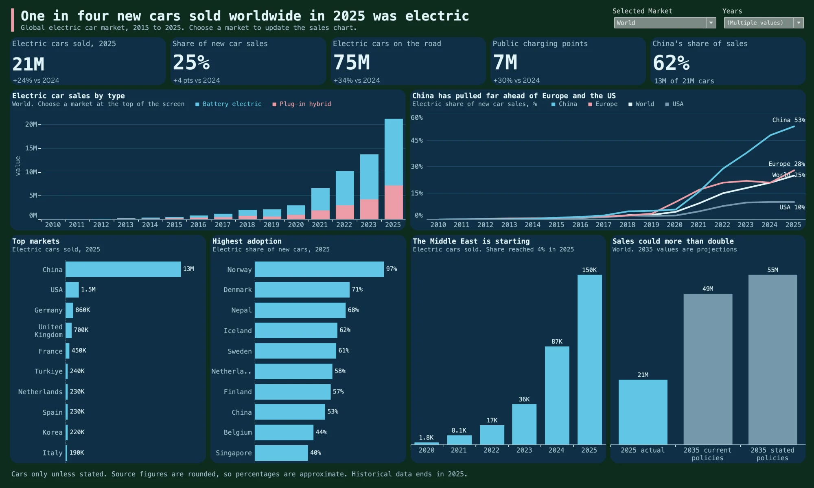

# Global Electric Car Sales

One in four new cars sold worldwide in 2025 was electric. This project measures how fast electric cars are growing, where adoption is strongest, and what the trend means for emerging markets such as the Middle East and Caspian region.

## Key results

- **25%** of new cars sold worldwide in 2025 were electric, up 4 points in one year.
- **62%** of global electric car sales came from China, 13M of 21M.
- **+72%** growth in the Middle East and Caspian region in one year, from 87K to 150K cars and a 4% share.

**Recommendation:** build public charging ahead of demand in the Middle East and Caspian region. The source reports 96 electric cars and vans per public charging point there, against a world average of 11.

## Data

Source: [EV SALE GLOBALLY 2010 - 2025 | FORCASTING 2035](https://www.kaggle.com/datasets/ahsan442002/ev-sale-globally-2025) by Ahsan Sajjad, Apache 2.0 licence. The original file is in `data/raw`.

Saudi Arabia is not in this file. The United Arab Emirates and the Middle East and Caspian region are. Source values are rounded, so country rows do not add up exactly to World, and growth rates on small markets are approximate.

## Steps

1. `python/clean_ev.py` removes duplicates, separates history from projections, splits the file into a market table and a price table, and writes the cleaning log.
2. `excel/ev_cleaning.xlsx` holds the summary, cleaning log, cleaned tables and original rows.
3. `dashboard/ev_dashboard.twbx` is the Tableau dashboard.

To run the cleaning: `python3 python/clean_ev.py data/raw/ev_data_by_country_2026.csv data`.

## Tools

Python, Excel, Tableau
